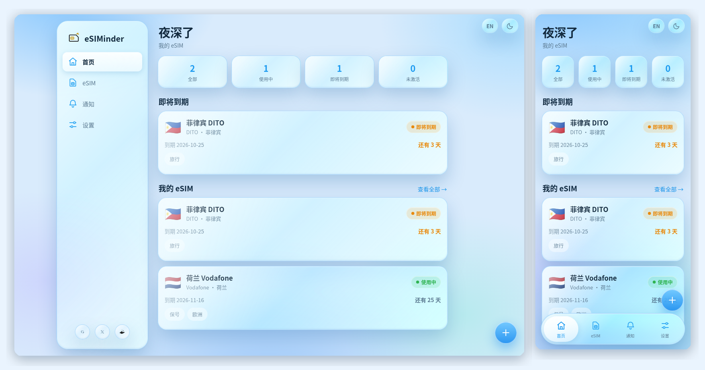
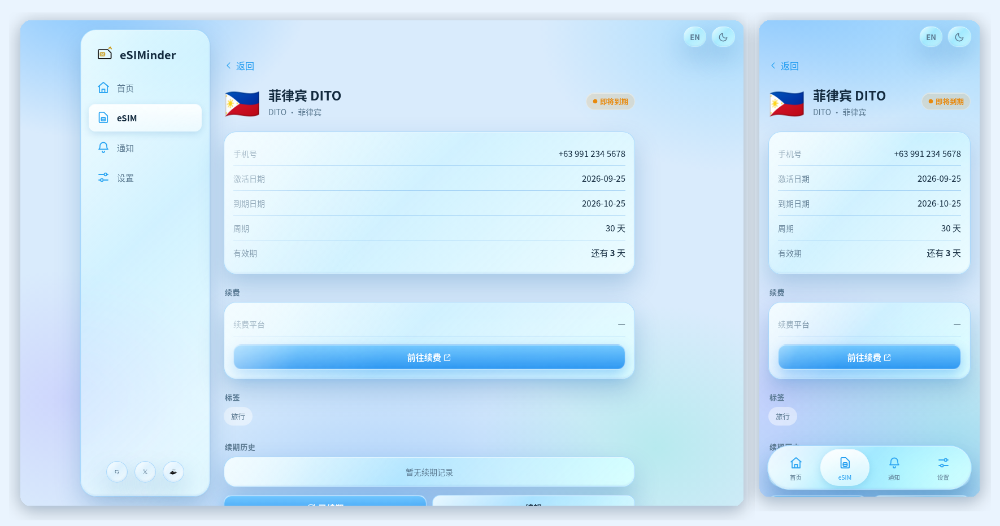
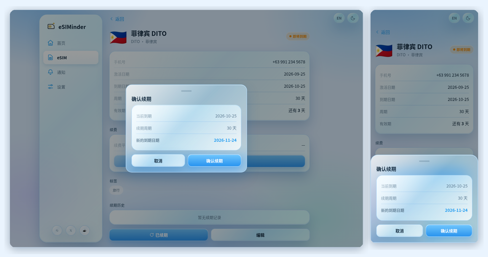
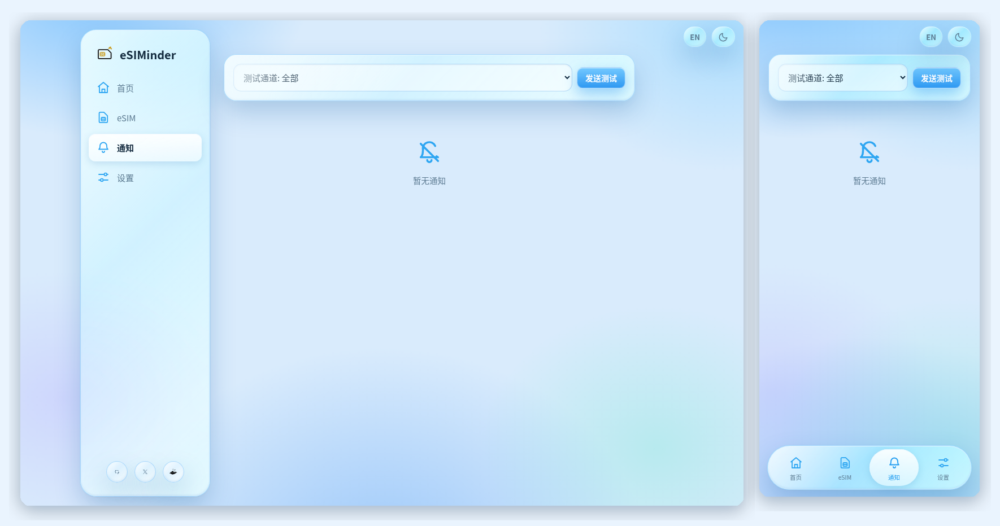
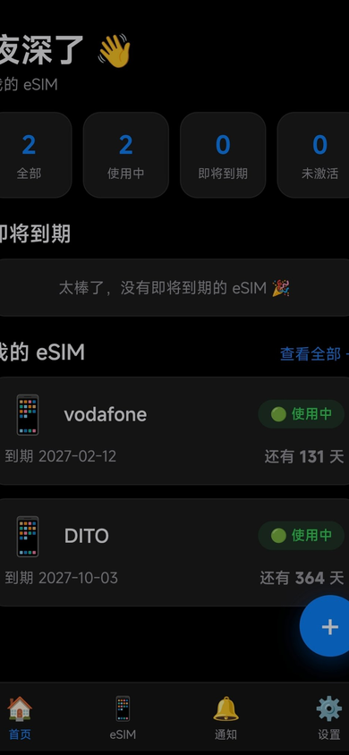

<p align="center">
  <a href="./README.md">🇨🇳 中文</a>
  ·
  <a href="./README.en.md">🇬🇧 English</a>
</p>

<h1 align="center">eSIMinder 🔔</h1>

<p align="center">
  <strong>Personal eSIM Lifecycle Manager</strong><br>
  Manage eSIMs · Track expiry · Get reminders · Renew in one click
</p>

<p align="center">
  <a href="https://deploy.workers.cloudflare.com/?url=https://github.com/Newbee06/esiminder"></a>
</p>

<p align="center">
  <a href="https://x.com/BTC108_">𝕏 @BTC108_</a>
</p>

---

> Landed abroad only to find your eSIM expired yesterday? eSIMinder reminds you before that happens — every card stays connected.

## ✨ Core Features

### 📱 eSIM Management

Keep every card in one place: name, country / region, carrier, phone number, activation date, expiry date, renewal cycle, and renewal link. Tags, search, and status filters included; statuses (active / expiring soon / expired / inactive) are computed automatically from dates — no manual upkeep.

### 🔔 Expiry Reminders

Staged reminders at 7 / 3 / 1 / 0 days before expiry, with customizable lead days. Configure once and get notified everywhere: 7 channels — Telegram, WeCom, DingTalk, Feishu, Bark, ServerChan, and Email (Resend).

### 🔄 One-Click Renewal

One click computes the new expiry date from the renewal cycle. Expired cards can be renewed too; preview before you confirm, history after you do, and `requestId` idempotency makes sure a double-tap never double-renews.

### ☁️ Cloudflare Deployment

Fully hosted on Workers + D1 + KV — zero servers, zero maintenance. One click on the deploy button installs it into your own Cloudflare account; your data stays entirely yours.

> **Design philosophy**
>
> One job, done well: managing your personal eSIMs. No sign-up, no multi-user, no payments, no finance features — simple, sufficient, quiet.

## 🖥️ Screenshots

### Dashboard

<p align="center">
  
</p>

### eSIM Detail

<p align="center">
  
</p>

### One-Click Renewal

<p align="center">
  
</p>

### Notification Center

<p align="center">
  
</p>

### Mobile

<p align="center">
  
</p>

## 👤 Who It's For

- Frequent travelers with a pocketful of travel eSIMs
- Anyone keeping long-term overseas numbers alive
- Anyone who can't remember when each card expires
- Anyone tired of landing with no signal

## 🎨 Interface

An iOS Liquid Glass design — translucent and restrained. Light / Dark / System themes, switched from the top-right corner. Bottom Tab Bar on mobile, left Sidebar on desktop; Chinese / English bilingual UI.

## 🚀 Deployment

### A. One-click deployment

[](https://deploy.workers.cloudflare.com/?url=https://github.com/Newbee06/esiminder)

1. Click **Deploy to Cloudflare**, log in and pick your own Cloudflare Account
2. Set `ADMIN_TOKEN` when prompted (this becomes your admin password)
3. Cloudflare provisions a fresh D1 / KV and deploys the Worker — no manual database setup
4. Open your Worker URL, log in with `ADMIN_TOKEN`, and change your password in Settings after first login

> Every deployment uses D1 / KV in the deployer's own account — fully isolated from the repo author's resources. `ADMIN_TOKEN` lives only in Cloudflare's secret storage; it never enters GitHub.

### B. Manual deployment

```bash
npm install
npx wrangler kv namespace create CFG   # optional: auto-provisioned on deploy
npx wrangler d1 create esiminder-db    # optional: auto-provisioned on deploy
npx wrangler secret put ADMIN_TOKEN
npx wrangler deploy
```

> If the CLI returns resource IDs, write them only to your local `wrangler.toml` — never commit them to a public repo.

## 🔔 Notification Channel Setup Guide

Go to **Settings → Notification Channels**, pick a channel, fill in its secrets, and hit **Saved**. Then verify from the Notifications page with **Send Test**.

| Channel | What to fill in | How to get it |
|---|---|---|
| Telegram | Bot Token, Chat ID | 1. Talk to [@BotFather](https://t.me/BotFather), send `/newbot`, and get the Token<br>2. Send your bot a message first (or add it to a group and post there)<br>3. Open `https://api.telegram.org/bot<TOKEN>/getUpdates` and find `chat.id` (group IDs are negative) |
| WeCom | Webhook | Group chat top-right `···` → Group Bot → Add Bot, copy the Webhook (no secret needed) |
| DingTalk | Webhook, sign secret | Group Settings → Bots → Add Custom Bot; choose "Sign" security, copy the Webhook and the `SEC...` secret |
| Feishu | Webhook, sign secret (optional) | Group Settings → Bots → Add Custom Bot, copy the Webhook; copy the secret too if signature verification is on |
| Bark (iOS) | Key | Install Bark from the App Store; the home screen shows your server URL — enter the Key (the part after `/`) |
| ServerChan | SendKey | Go to [sct.ftqq.com](https://sct.ftqq.com), log in with WeChat, copy your SendKey (starts with `SCT`) |
| Email (Resend) | API Key, From, To | Sign up at [resend.com](https://resend.com) and verify a sending domain → create a Key on the API Keys page (starts with `re_`) → From = an address on that domain, To = your inbox |

## 🆕 What's New in V2.1

| Feature | Description |
|---|---|
| Renewal Idempotency | `requestId` prevents duplicate renewals |
| Atomic Renewal | Single D1 transaction — all or nothing |
| Notification Dedup | Dedup state stored in D1, automatic retry on failure |
| Date Validation | Invalid dates are rejected, keeping data clean |
| Config Validation | Reminder days normalized, timezone validated server-side |
| Notification Timeout | Uniform 10-second timeout on all channels |

## 🏗️ Architecture

Cloudflare Workers + D1 + KV. No other dependencies.

- Tables are created automatically on first request — no manual SQL
- Older data migrates automatically (V1 → V2, V2.0 → V2.1); migrations are idempotent and safe to re-run
- Cron `0 1 * * *` checks expiries and sends reminders daily at 09:00 Beijing time

## 🗄️ Data Model

```
D1
├── esims
├── renewal_records
├── notifications
├── settings
├── notification_dedup
└── renew_idempotency

KV
├── channels
├── admin_token
├── sess:*
├── login:rl:*
└── migration markers
```

## 📡 API

| Method | Endpoint | Description |
|---|---|---|
| POST | `/api/login` | Login |
| GET / POST | `/api/esims` | List / Create |
| GET / PUT / DELETE | `/api/esims/:id` | Detail / Update / Delete |
| POST | `/api/esims/:id/renew` | Renew (`requestId` idempotent) |
| GET | `/api/dashboard` | Dashboard data |
| GET | `/api/notifications` | Notification history |
| GET / PUT | `/api/settings` | Settings |

## 🧪 Tests

```bash
npm test
```

75 tests covering: renewal idempotency, concurrent renewal, notification deduplication, notification retry, date validation, configuration validation, Cron, migration, and deployment configuration.

## ⚠️ Known Notes

- Reminder checks run at 09:00 Beijing time; the timezone setting only affects the "today" date boundary
- The email channel runs on Resend; the sending domain must be verified there first
- Notification history is not auto-pruned (negligible for personal use)

## 🤝 Author

Created by [𝕏 @BTC108_](https://x.com/BTC108_)

## License

MIT
